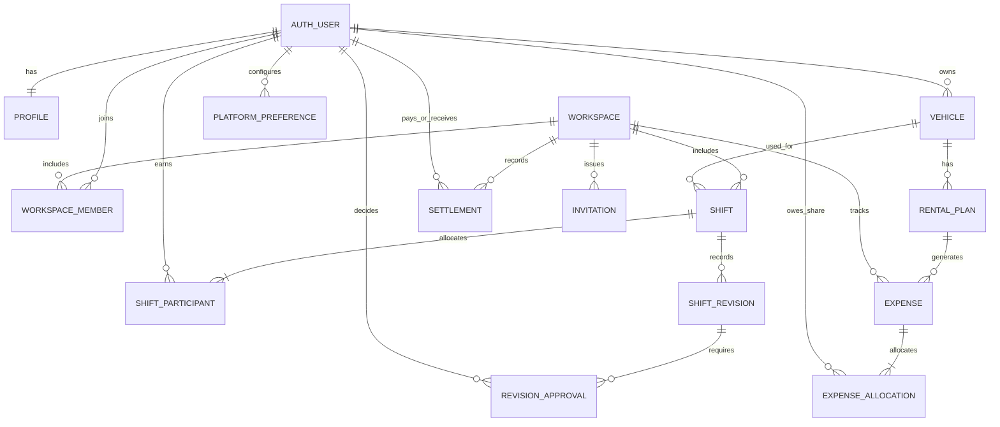

# Courier Ledger — Data & Architecture v0.3

Статус: предварительная схема для обсуждения. Не готовая SQL-миграция.

## Архитектурный принцип

Браузер — недоверенная среда. База PostgreSQL хранит первичные факты, а не только готовые итоги. Доли, балансы и статусы согласования меняются через атомарные серверные операции с проверкой прав. Для публичного API включены RLS + минимальные grants; админский service key никогда не доступен фронтенду.

## ER (концептуально)

## Сущности

| Entity | Ключевые поля и смысл |
|---|---|
| `profiles` | auth user id, nickname, preferred_locale, preferred_currency_code, created_at |
| `workspaces` | id, name, owner_user_id, currency_code, timezone, created_at |
| `workspace_members` | workspace_id, user_id, role, joined_at, left_at |
| `invitations` | workspace_id, token_hash, expires_at, invited_email?, status |
| `vehicles` | id, owner_user_id, name, type, default_consumption, archived_at |
| `platform_preferences` | user_id, platform_id, default_commission_bps (basis points) |
| `shifts` | id, workspace_id, creator_id, visibility (private/shared), starts_at, ends_at, platform_id, vehicle_id, orders_count, distance_km_decimal, fuel_liters_decimal, fuel_price_minor_per_liter, gross_revenue_minor, currency_code, commission_bps_snapshot, payout_recipient_user_id, payout_status, status |
| `shift_participants` | shift_id, user_id, revenue_share_bps, fuel_share_bps?, worked_minutes |
| `shift_revisions` | shift_id, revision_number, proposed_by, proposed_payload, state, created_at |
| `revision_approvals` | shift_revision_id, user_id, approved/rejected, decided_at |
| `rental_plans` | vehicle_id, recurring weekly/monthly optional, amount_minor, currency_code, payer_user_id, coverage_starts_on/coverage_ends_on; split arrangement |
| `expenses` | id, workspace_id, vehicle_id?, source (manual/rental), rental_period_key?, category, amount_minor, currency_code, paid_by_user_id, incurred_at, coverage_starts_on?, coverage_ends_on?, status |
| `expense_allocations` | expense_id, user_id, share_minor (sum exact expense amount) |
| `settlements` | id, workspace_id, from_user_id, to_user_id, amount_minor, currency_code, paid_at, note |
| `audit_events` | actor_user_id, entity, entity_id, operation, at, details (sanitized) |

`AUTH_USER` обозначает запись в Supabase Auth (не отдельную пользовательскую таблицу приложения). Для многопользовательского начисления долей в будущем модель допускает более двух участников, хотя MVP-форма будет работать с двумя.

## Авторизация и приватность

- `private` shifts: только владелец/автор (и назначенные участники, если они существуют; в MVP личная смена имеет ровно одного участника).
- `shared` shifts: только отмеченные участники; остальные участники workspace не получают полные детали автоматически.
- Team dashboard / API использует **исключительно общие смены и общие расходы**; личные записи не включаются даже в агрегат.
- `shift_revisions`: видеть и голосовать могут только участники соответствующей смены. Исходная смена не редактируется до всех подтверждений.
- `expense_allocations`: каждому доступна его доля и относящаяся к нему информация; рабочие расходы с разрешенной общедоступностью — команде. Нужны тесты на утечку через joins/views и суммарные API.
- Личные записи никогда не входят в общий показатель, поэтому сумма другого участника не выводится вычитанием командного результата из личного.

## Снимки настроек

Для смены сохраняются: `commission_bps_snapshot`, `fuel_price`, `fuel_liters` (из фактического замера или расчета), `vehicle_name_snapshot?` если переименование важно для отчета. Данные отчетов не меняются вслед за настройками. При исправлении смены новая ревизия меняет только явно выбранные поля.

## Денежный учет

Финансовые значения — integer minor units (`100 CZK = 10000` геллеров; для EUR/USD/UAH также 2 minor units на основную единицу), доли — basis points (`5000 = 50%`), промежуточные расчетные величины — decimal с однозначной политикой округления. Для каждого shared revenue/expense детерминированно распределять остаток от округления одному участнику, чтобы сумма долей была равна сумме записи.

`accrued_profit` отличается от `cash_received` и от `inter_member_balance`. Например, при выручке 1000 Kč с одного аккаунта A и долях A/B 50/50: прибыль обоих до расходов +500 Kč; A фактически получил 1000 Kč, следовательно должен B 500 Kč. При этом возврат долга не изменяет прибыль.

Для расчета с несколькими пользователями в будущем задолженности можно хранить в виде неизменяемых операций, а не мутируемого поля баланса. Материализованные итоги — только кэш, который можно полностью восстановить.

## Риск-анализ

1. **Double charge:** rental plan генерирует начисление по уникальному `(rental_plan_id, period_start)`, не при открытии страницы.
2. **Double income:** одна смена однажды учитывается в командном gross; индивидуальные доли суммируются в исходную выручку.
3. **Concurrent edits:** версионирование + optimistic lock, подтверждения на конкретную ревизию.
4. **Historical changes:** snapshots ставок и цен; без молчаливого пересчета.
5. **Security leakage:** тестировать обычные записи, отчеты, экспорт, RLS, security definer functions и multi-tenant границы.
6. **Timezone:** timestamps UTC, отображение локальное; week definition явная и согласованная, DST корректно.

## Наиболее подходящий кандидат стека

- React / TypeScript / Vite
- Tailwind + shadcn/ui
- Supabase Auth + PostgreSQL
- SQL migrations + RLS + ограниченные RPC/Edge Functions для approvals, расчетов, недельных начислений аренды
- Cloudflare Pages (GitHub integration, preview deployments)
- Vitest + Playwright + SQL RLS tests

Официальные материалы: https://supabase.com/docs/guides/database/postgres/row-level-security и https://developers.cloudflare.com/pages/framework-guides/deploy-a-react-site/

## Мультивалютная модель и ограничения v0.3

- На уровне `profiles` храним `preferred_currency_code`, на уровне `workspaces` — `currency_code`. Привязка каждой суммы к валюте обязательна (check constraint `IN ('CZK','EUR','USD','UAH')`).
- `workspace.currency_code` неизменяема после первой финансовой записи (или требуется будущая специальная операция миграции с полной ревизией); простая смена настройки пользователя не меняет ни сумму, ни валюту прошлых операций.
- В MVP все смены, расходы, аренды и взаиморасчёты одного workspace используют **одну валюту**; foreign currency entry возвращает ошибку валидации. Личный workspace в другой валюте создаётся отдельно.
- Никакого суммирования смешанных валют, currency sign replacement или автоматического FX. Будущее расширение: отдельная сущность `fx_conversion` c source/target, rate, rate_date, rate_provider, amount_in/out и аудируемыми округлениями.
- Currency minor units и доли денег хранятся целыми, ставки процентов — basis points, дистанции/литры — decimal. Backend/RPC валидируют инварианты, клиентские значения не являются источником истины.

## Доступность данных workspace v0.3

- Только `shared`-смены и распределённые **общие** расходы попадают в отчёт команды. `private`-смены видит исключительно владелец, включая агрегаты, export и поисковые выборки.
- На совместной смене `payout_recipient_user_id` — обязательный participant id. Для MVP один получатель. Начисление долей и изменение взаиморасчётов происходят атомарно после подтверждения смены/ревизии.
- При изменении/удалении совместной смены сохраняется старая активная версия до подтверждения всех участников; изменённая версия формирует **перерасчёт**, а не повторное начисление.

## Учет аренды v0.3

- `rental_periods` (рекомендуется выделить таблицу из `rental_plans`): `id, vehicle_id, coverage_start_date, coverage_end_date_exclusive, total_minor, currency_code, paid_by_user_id, status`. `rental_allocations` распределяют сумму по пользователям.
- Для календарных отчётов стоимость аренды распределяется пропорционально количеству локальных календарных дней покрытия, попавших в запрашиваемый период. Округление остатка закрепляется за последним днем/периодом так, чтобы суммы сходились в исходную общую стоимость.
- Вне зависимости от среза отчета полная договорённость об аренде создает обязательства участников на весь срок при подтверждении; экран «сколько осталось отбить» показывает **полный непокрытый размер**, а дневной/месячный P&L — признанную долю на даты. Погашение обязательства не изменяет прибыль.
- Если аренда оплачена A, а доля B=50%, B должен A соответствующую сумму независимо от того, в какие дни B выполнял личные или совместные смены. Изменение долей — согласованная ревизия.

## Решение 2026-11-06 (v0.4): финальная модель валют для MVP

Выбран единственный режим: **учёт в локальной валюте workspace, без FX**. На уровне профиля `preferred_currency_code` — лишь default для новых workspaces. `workspaces.currency_code` определяет денежную единицу всех финансовых фактов внутри workspace. Валюта непустого workspace не редактируется напрямую через интерфейс или API. Имеющиеся денежные факты не переименовываются и не пересчитываются при изменении профиля. Таблицы, содержащие деньги, используют `amount_minor bigint`, `currency_code`, `check currency_code in ('CZK','EUR','USD','UAH')`; серверная функция проверяет соответствие валюты workspace. Финансовые агрегаты и долги складываются только при одинаковом currency_code. В клиентском TypeScript применяется `bigint` для денежных операций, в JSON/DB bigint — десятичная строка. В каждой комнате остается одна валюта; межвалютная аналитика после MVP.

**Scope первой миграции:** только `profiles` + личные `workspaces` + RLS. Смены, приглашения, расчёты и командные рабочие пространства — следующие защищённые миграции после тестов RLS и транзакционных функций. Не публиковать интерфейс для финансовых записей до этих проверок.
